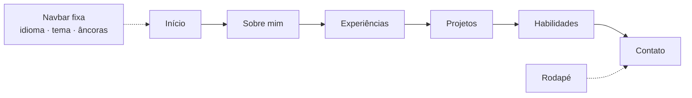

# Portfólio Dev — Larissa Cravo

Portfólio pessoal de **Larissa Cravo Carvalho Câmara Santos**, Engenheira de Software Full Stack, desenvolvido como uma _single page application_ multilíngue, responsiva e com animações. O site apresenta perfil profissional, experiências, projetos, habilidades técnicas, currículo em PDF e um formulário de contato.

🌐 **Site publicado:** [l4r1ss4cr4v0.dev](https://l4r1ss4cr4v0.dev)

---

## Sumário

- [Descrição do projeto](#descrição-do-projeto)
- [Protótipos](#protótipos)
- [Estrutura do site](#estrutura-do-site)
- [Funcionalidades](#funcionalidades)
- [Tecnologias previstas e utilizadas](#tecnologias-previstas-e-utilizadas)
- [Dependências e bibliotecas](#dependências-e-bibliotecas)
- [Projetos em destaque](#projetos-em-destaque)
- [Estrutura de diretórios](#estrutura-de-diretórios)
- [Instalação e execução local](#instalação-e-execução-local)
- [Variáveis de ambiente](#variáveis-de-ambiente)
- [Scripts disponíveis](#scripts-disponíveis)
- [Internacionalização](#internacionalização)
- [Deploy e acesso na nuvem](#deploy-e-acesso-na-nuvem)
- [Contato](#contato)

---

## Descrição do projeto

Este projeto é o portfólio profissional de Larissa, criado para reunir em um só lugar sua trajetória, seus projetos e suas habilidades, facilitando o contato com recrutadores, clientes e colegas de área.

**Objetivos**

- Apresentar o perfil profissional, a formação e as experiências de forma clara e atrativa.
- Exibir projetos com descrição, tecnologias, imagens e links para demonstração e repositório.
- Oferecer o currículo em PDF nos três idiomas do site.
- Disponibilizar um canal de contato direto, com proteção contra spam.

**Público-alvo:** recrutadores, empresas, clientes e profissionais da área de tecnologia.

---

## Protótipos

Antes do desenvolvimento, o layout do site foi planejado em protótipos de baixa e alta fidelidade.

🎨 **Protótipo navegável (Figma):** [adicionar link do Figma](https://www.figma.com/)

### Versão desktop

| Início | Sobre mim | Projetos |
| :----: | :-------: | :------: |
|  |  |  |

### Versão mobile

| Início | Projetos | Contato |
| :----: | :------: | :-----: |
|  |  |  |

### Resultado final

| Tema claro | Tema escuro |
| :--------: | :---------: |
|  |  |

> 📌 Salve as imagens na pasta `docs/prototipos/` com os nomes acima (ou ajuste os caminhos).

---

## Estrutura do site

O site é uma página única, com navegação por âncoras entre as seções, e uma página 404 personalizada para rotas inexistentes.



| Seção            | Conteúdo                                                                         |
| ---------------- | -------------------------------------------------------------------------------- |
| **Início**       | Apresentação, cargo, foto de perfil e links para LinkedIn, GitHub e WhatsApp     |
| **Sobre mim**    | Formação, áreas de interesse e indicadores de destaque                           |
| **Experiências** | Moderna Soluções, monitoria na PUC Minas e Guizi Consultoria                     |
| **Projetos**     | Cards com descrição, tecnologias, imagem e links para demo e repositório         |
| **Habilidades**  | Tecnologias organizadas em Frontend, Backend, Mobile, Cloud & DevOps e Data & AI |
| **Contato**      | Informações de contato e formulário de mensagem                                  |

**Elementos globais:** barra de navegação com seletor de idioma e alternância de tema, rodapé e modal de visualização do currículo.

---

## Funcionalidades

- **Três idiomas:** Português (padrão), Inglês e Espanhol, com seletor de idioma e preferência salva no navegador.
- **Tema claro e escuro** alternável pela barra de navegação.
- **Visualizador de currículo** em modal (PDF), com um arquivo para cada idioma.
- **Formulário de contato** com envio por e-mail via EmailJS e proteção anti-spam com reCAPTCHA.
- **Animações e efeitos visuais:** parallax nos títulos, card com inclinação 3D, texto com efeito "decrypt", entradas suaves ao rolar a página e cartões com efeito _glass_.
- **Layout responsivo**, com navegação por âncoras entre as seções.
- **Página 404** personalizada.
- **SEO básico** com `robots.txt` liberando os principais rastreadores e redes sociais.

---

## Tecnologias previstas e utilizadas

**Base**

- [React 18](https://react.dev/) + [TypeScript](https://www.typescriptlang.org/)
- [Vite 5](https://vitejs.dev/) com [SWC](https://swc.rs/) (`@vitejs/plugin-react-swc`)
- [React Router](https://reactrouter.com/) para roteamento

**Interface**

- [Tailwind CSS 3](https://tailwindcss.com/) com `tailwindcss-animate` e `@tailwindcss/typography`
- [shadcn/ui](https://ui.shadcn.com/) (estilo _new-york_) sobre [Radix UI](https://www.radix-ui.com/)
- [Framer Motion](https://www.framer.com/motion/) e [Motion](https://motion.dev/) para animações
- [Lucide React](https://lucide.dev/) para ícones e [flag-icons](https://github.com/lipis/flag-icons) para bandeiras
- [next-themes](https://github.com/pacocoursey/next-themes), [Sonner](https://sonner.emilkowal.ski/) e [Vaul](https://vaul.emilkowal.ski/)

**Funcionalidades**

- [i18next](https://www.i18next.com/) + [react-i18next](https://react.i18next.com/) para tradução
- [react-pdf](https://github.com/wojtekmaj/react-pdf) para exibir o currículo
- [EmailJS](https://www.emailjs.com/) e [react-google-recaptcha](https://github.com/dozoisch/react-google-recaptcha) para o formulário de contato
- [React Hook Form](https://react-hook-form.com/) + [Zod](https://zod.dev/) para formulários e validação
- [TanStack Query](https://tanstack.com/query)

**Qualidade**

- [ESLint](https://eslint.org/) com `typescript-eslint`
- [Vitest](https://vitest.dev/) + Testing Library

**Design e hospedagem**

- [Figma](https://www.figma.com/) para os protótipos
- [GitHub](https://github.com/) para versionamento e [Vercel](https://vercel.com/) para publicação

---

## Dependências e bibliotecas

Relação das principais dependências do projeto. As versões exatas estão no arquivo [`package.json`](./package.json).

### Dependências de produção

| Pacote                                   | Versão      | Uso                                        |
| ---------------------------------------- | ----------- | ------------------------------------------ |
| `react` / `react-dom`                    | ^18.x       | Biblioteca de interface                    |
| `react-router-dom`                       | ^x.x.x      | Roteamento                                 |
| `tailwindcss-animate`                    | ^x.x.x      | Utilitários de animação para o Tailwind    |
| `@radix-ui/*`                            | ^x.x.x      | Primitivos de UI acessíveis (via shadcn/ui)|
| `framer-motion` / `motion`               | ^x.x.x      | Animações                                  |
| `lucide-react`                           | ^x.x.x      | Ícones                                     |
| `flag-icons`                             | ^x.x.x      | Bandeiras dos idiomas                      |
| `next-themes`                            | ^x.x.x      | Tema claro e escuro                        |
| `sonner`                                 | ^x.x.x      | Notificações (toasts)                      |
| `vaul`                                   | ^x.x.x      | Drawer / menu mobile                       |
| `i18next` / `react-i18next`              | ^x.x.x      | Internacionalização                        |
| `react-pdf`                              | ^x.x.x      | Visualização do currículo em PDF           |
| `@emailjs/browser`                       | ^x.x.x      | Envio de e-mails pelo formulário           |
| `react-google-recaptcha`                 | ^x.x.x      | Proteção anti-spam                         |
| `react-hook-form` / `zod`                | ^x.x.x      | Formulários e validação                    |
| `@tanstack/react-query`                  | ^x.x.x      | Gerenciamento de requisições               |

### Dependências de desenvolvimento

| Pacote                                   | Versão      | Uso                                        |
| ---------------------------------------- | ----------- | ------------------------------------------ |
| `vite`                                   | ^5.x        | Bundler e servidor de desenvolvimento      |
| `@vitejs/plugin-react-swc`               | ^x.x.x      | Compilação React com SWC                   |
| `typescript`                             | ^x.x.x      | Tipagem estática                           |
| `tailwindcss` / `postcss` / `autoprefixer` | ^3.x      | Estilização                                |
| `@tailwindcss/typography`                | ^x.x.x      | Estilos de texto                           |
| `eslint` / `typescript-eslint`           | ^x.x.x      | Análise estática                           |
| `vitest`                                 | ^x.x.x      | Testes                                     |
| `@testing-library/react`                 | ^x.x.x      | Testes de componentes                      |

> 📌 Substitua os `x.x.x` pelas versões que aparecem no seu `package.json`.

---

## Projetos em destaque

Os projetos exibidos no portfólio estão cadastrados em `src/lib/itens.ts`:

| Projeto           | Descrição                                                                             | Tecnologias                                                    |
| ----------------- | ------------------------------------------------------------------------------------- | -------------------------------------------------------------- |
| **Structa**       | Plataforma de gestão de demandas e problemas no ambiente escolar                      | HTML, CSS, JavaScript, Node.js, JSON Server, Bootstrap, jQuery |
| **Barzêro**       | App para descobrir bares em Belo Horizonte, com recomendações e cupons demonstrativos | React Native, Expo, TypeScript, Prisma, SQLite                 |
| **WeatherApp**    | Clima de Belo Horizonte em tempo real, com modo claro e escuro                        | React Native, TypeScript, OpenWeatherMap                       |
| **Contactei API** | API RESTful para gerenciar usuários, contatos e grupos (CRUD)                         | TypeScript, Node.js, Express, Prisma                           |
| **Elitphoto**     | Template de site para fotógrafo, com layout minimalista                               | HTML, CSS                                                      |
| **CineMust**      | Site de busca com 20 filmes imperdíveis                                               | HTML, CSS, JavaScript, JSON                                    |
| **Eiffel Lens**   | API que usa IA (Gemini) para explorar imagens surreais da Torre Eiffel                | Node.js, MongoDB, Gemini API                                   |

---

## Estrutura de diretórios

```text
.
├── docs/
│   └── prototipos/          # Imagens dos protótipos (desktop, mobile e resultado final)
├── public/
│   ├── files/               # Currículos em PDF (ptBR, en, es)
│   ├── projects/            # Imagens dos projetos
│   ├── Perfil.jpg           # Foto de perfil
│   ├── favicon.png
│   └── robots.txt
├── src/
│   ├── components/
│   │   ├── layout/          # Navbar e Footer
│   │   ├── sections/        # Hero, About, Experiences, Projects, Skills, Contact
│   │   ├── ui/              # Componentes do shadcn/ui
│   │   └── ...              # CustomForms, PDFViewer, TiltedCard, ParallaxTitle etc.
│   ├── hooks/               # useInView, useParallax, use-mobile, use-toast
│   ├── lib/
│   │   ├── languages/       # i18n.ts e traduções (pt-br.json, en.json, es.json)
│   │   ├── itens.ts         # Dados do site: contatos, projetos, experiências e tecnologias
│   │   └── utils.ts
│   ├── pages/               # Index e NotFound
│   ├── App.tsx
│   └── main.tsx
├── CNAME                    # Domínio personalizado (l4r1ss4cr4v0.dev)
├── package.json             # Dependências e scripts
├── tailwind.config.ts
├── vite.config.ts
└── vitest.config.ts
```

---

## Instalação e execução local

**Pré-requisitos:** [Node.js](https://nodejs.org/) 18 ou superior, npm e [Git](https://git-scm.com/).

```bash
# 1. Clone o repositório
git clone https://github.com/L4r1ss4Cr4v0/PortifolioDev.git
cd PortifolioDev

# 2. Instale as dependências
npm install

# 3. Configure as variáveis de ambiente (veja a seção abaixo)

# 4. Inicie o servidor de desenvolvimento
npm run dev
```

O site ficará disponível em `http://localhost:8080`.

Para testar a versão de produção localmente:

```bash
npm run build
npm run preview
```

---

## Variáveis de ambiente

Crie um arquivo `.env` na raiz do projeto. Ele é necessário para o funcionamento do formulário de contato:

```env
VITE_EMAILJS_SERVICE_ID=seu_service_id
VITE_EMAILJS_TEMPLATE_ID=seu_template_id
VITE_EMAILJS_PUBLIC_KEY=sua_public_key
VITE_RECAPTCHA_SITE_KEY=sua_site_key
```

> ⚠️ Variáveis com prefixo `VITE_` são incluídas no código enviado ao navegador. Use apenas chaves **públicas** e nunca versione o arquivo `.env`.

---

## Scripts disponíveis

| Comando              | Descrição                                          |
| -------------------- | -------------------------------------------------- |
| `npm run dev`        | Inicia o servidor de desenvolvimento na porta 8080 |
| `npm run build`      | Gera a build de produção na pasta `dist`           |
| `npm run build:dev`  | Gera a build em modo de desenvolvimento            |
| `npm run preview`    | Serve localmente a build de produção               |
| `npm run lint`       | Executa o ESLint                                   |
| `npm test`           | Executa os testes uma vez com o Vitest             |
| `npm run test:watch` | Executa os testes em modo _watch_                  |

---

## Internacionalização

As traduções ficam em `src/lib/languages/`:

| Idioma             | Código | Arquivo      |
| ------------------ | ------ | ------------ |
| Português (padrão) | `ptBR` | `pt-br.json` |
| English            | `en`   | `en.json`    |
| Español            | `es`   | `es.json`    |

Para alterar textos, edite o JSON do idioma correspondente. Dados que não dependem de idioma (links, tecnologias, nomes de projetos) ficam em `src/lib/itens.ts`. Para adicionar um novo idioma, crie o arquivo JSON, registre-o em `i18n.ts` e inclua-o na lista `languages` de `itens.ts`.

---

## Deploy e acesso na nuvem

🌐 **Acesse o site publicado:** [https://l4r1ss4cr4v0.dev](https://l4r1ss4cr4v0.dev)

O projeto é publicado na [Vercel](https://vercel.com/) a partir do repositório no GitHub, com o domínio personalizado **l4r1ss4cr4v0.dev** (definido no arquivo `CNAME`).

- **Comando de build:** `npm run build`
- **Diretório de saída:** `dist`
- **Variáveis de ambiente:** configure as mesmas chaves do `.env` no painel do projeto na Vercel.

---

## Contato

**Larissa Cravo Carvalho Câmara Santos** — Belo Horizonte, MG, Brasil

- 📧 [l4r1ss4cr4v0ccamara@gmail.com](mailto:l4r1ss4cr4v0ccamara@gmail.com)
- 💼 [LinkedIn](https://www.linkedin.com/in/larissa-cravo-carvalho-camara-santos-154b66306/)
- 🐙 [GitHub](https://github.com/L4r1ss4Cr4v0)
